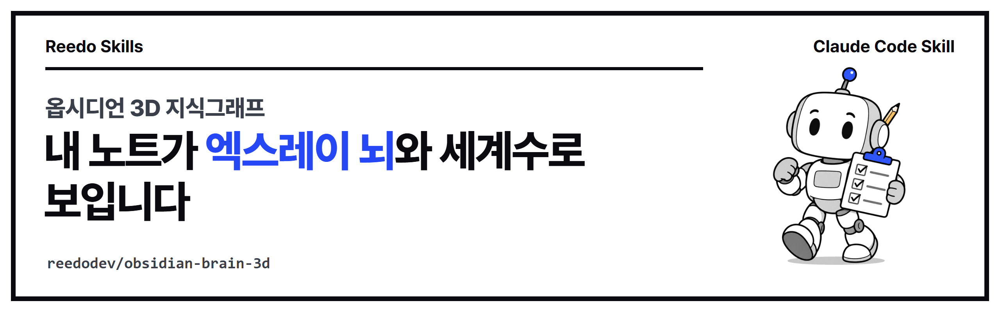
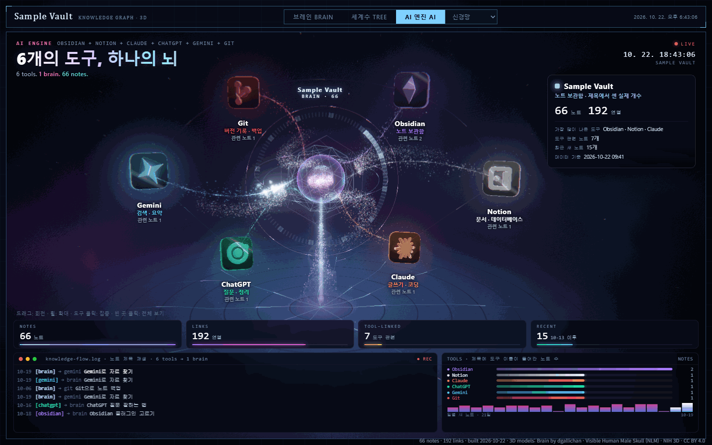

<p align="center"><a href="README.md">English</a> | <b>한국어</b></p>

<p align="center"></p>

<p align="center">
<a href="https://github.com/reedodev/obsidian-brain-3d/actions/workflows/test.yml"></a>


</p>

# 옵시디언 3D 지식그래프 (obsidian-brain-3d)

**옵시디언 노트를 3D 엑스레이 뇌 속 빛나는 점으로 보여 주고, 키 하나로 세계수 모양으로 바꿔 주는 도구입니다.**

<p align="center"></p>

## 한눈에 보기

내 노트가 엑스레이 뇌와 두개골 속 점으로 나타납니다. `T` 키를 누르면 세계수 모양으로 바뀌고, `A` 키를 누르면 세 번째 탭 「AI 엔진」에서 내가 쓰는 도구들이 빛줄기로 가운데 뇌에 연결됩니다.

아래 여섯 칸에는 실제 노트 제목과 날짜, 연결 수가 나옵니다. 남에게 보여 줄 때는 제목과 분류 이름을 가릴 수 있습니다.

**이런 분께 맞습니다**

- 옵시디언에 쌓은 노트를 한눈에 보고 싶은 분
- 내 노트를 블로그·영상·발표에서 멋진 화면으로 보여 주고 싶은 분
- 명령어를 한 번도 입력해 본 적 없는 분(아래에서 한 단계씩 안내합니다)

**3단계로 끝납니다**

| 단계 | 하는 일 | 쓰는 명령 |
| --- | --- | --- |
| 1. 받기 | 이 폴더를 내려받습니다 | `git clone` 또는 **Download ZIP** |
| 2. 만들기 | 노트로 화면 파일을 만듭니다 | `build-data.mjs` |
| 3. 열기 | 화면을 켜고 브라우저로 엽니다 | `serve.mjs` → `http://127.0.0.1:8770/` |

> [!NOTE]
> **참고:** 내 노트는 읽기만 합니다. 고치거나 지우지 않고, 인터넷에 올리지도 않습니다.

## 처음 5분 따라 하기

컴퓨터에 익숙하지 않아도 아래 순서대로 하면 됩니다.

먼저 함께 들어 있는 **예시 노트**로 화면을 띄워 보고, 잘 되면 내 보관함(옵시디언 노트 폴더)으로 바꿉니다.

### 1단계. 터미널 열기

터미널은 명령어를 글자로 입력하는 창입니다.

- **Windows**: 시작 버튼을 누르고 `PowerShell`을 입력한 뒤 「Windows PowerShell」을 누릅니다.
- **Mac**: `Command(⌘) + Space`를 누르고 `터미널`(또는 `Terminal`)을 입력한 뒤 Enter를 누릅니다.

### 2단계. Node.js가 있는지 확인하기

Node.js는 이 도구를 돌리는 무료 프로그램입니다. 아래 명령을 입력하고 Enter를 누릅니다.

```
node --version
```

- `v18`보다 큰 숫자(예: `v22.11.0`)가 나오면 3단계로 넘어갑니다.
- 「인식되지 않습니다」나 `command not found`가 나오면 [nodejs.org](https://nodejs.org)에서 **LTS**(오래 지원하는 안정판)를 받아 설치합니다.

> [!TIP]
> **도움말:** Node.js를 설치한 뒤에는 터미널을 **닫았다가 다시 열고** 한 번 더 확인합니다.

### 3단계. 이 폴더 받기

아래 두 방법 중 **하나만** 고릅니다.

**가. git이 있는 경우** (git은 코드를 내려받는 도구입니다)

```
git clone https://github.com/reedodev/obsidian-brain-3d.git
```

그다음 받은 폴더로 들어갑니다.

```
cd obsidian-brain-3d
```

**나. git이 없는 경우**

1. 이 페이지 위쪽의 초록색 **Code** 버튼 → **Download ZIP**을 누릅니다.
2. 받은 파일의 압축을 풉니다. Windows는 오른쪽 클릭 → 「모두 압축 풀기」를 누릅니다. 압축 파일 안에서 바로 실행하면 안 됩니다.
3. 풀린 폴더 이름은 `obsidian-brain-3d-main`입니다.
4. 터미널에 `cd `(cd 다음 띄어쓰기 한 칸)를 입력하고, 그 폴더를 터미널 창으로 끌어다 놓은 뒤 Enter를 누릅니다.

> [!TIP]
> **확인:** Windows는 `dir`, Mac은 `ls`를 입력했을 때 `README.md`와 `skills`가 보이면 제대로 들어온 것입니다.
> 아래 명령은 모두 **이 폴더 안에서** 입력합니다.

### 4단계. 예시 노트로 화면 만들기

아래 한 줄을 그대로 복사해 붙여 넣습니다.

```
node skills/obsidian-brain-3d/scripts/build-data.mjs skills/obsidian-brain-3d/examples/sample-vault --site brain-site
```

마지막에 `Done / 완료`가 나오면 성공입니다. 화면 파일이 든 `brain-site` 폴더가 새로 생깁니다.

### 5단계. 화면 켜기

```
node skills/obsidian-brain-3d/scripts/serve.mjs brain-site
```

`serving ... at http://127.0.0.1:8770/`이 나오면 화면이 켜진 것입니다.

> [!IMPORTANT]
> **중요:** 이 터미널은 **켜 둔 채로** 둡니다. 창을 닫으면 화면도 꺼집니다.

### 6단계. 브라우저로 열기

브라우저(Chrome·Edge·Safari 최신판) 주소창에 아래 주소를 입력합니다.

```
http://127.0.0.1:8770/
```

이 주소는 내 컴퓨터 안에서만 열리고 다른 사람은 볼 수 없습니다. 뇌가 보이면 아래처럼 움직여 봅니다.

| 조작 | 하는 일 |
| --- | --- |
| `T` 키 | 세계수 |
| `B` 키 | 뇌 |
| `A` 키 | AI 엔진 탭 |
| 끌기 | 돌리기 |
| 마우스 휠 | 확대·축소 |

### 7단계. 내 보관함으로 바꾸기

1. 5단계 터미널에서 `Ctrl + C`를 눌러 화면을 끕니다.
2. 4단계 명령의 예시 경로(`skills/obsidian-brain-3d/examples/sample-vault`) 자리에 **내 보관함 폴더 경로**를 넣어 다시 실행합니다.
3. 이어서 5단계와 6단계를 다시 합니다.

Windows 예:

```
node skills/obsidian-brain-3d/scripts/build-data.mjs "C:\Users\내이름\Documents\내 보관함" --site brain-site
```

Mac 예:

```
node skills/obsidian-brain-3d/scripts/build-data.mjs "/Users/내이름/Documents/내 보관함" --site brain-site
```

**보관함 경로 찾는 법**

- **가장 쉬운 방법**: 보관함 폴더를 터미널 창으로 끌어다 놓으면 경로가 저절로 입력됩니다.
- **Windows**: 탐색기 주소창을 눌러 경로를 복사합니다.
- **Mac**: Finder에서 폴더를 고른 뒤 `Option + Command + C`를 누르면 경로가 복사됩니다.

> [!NOTE]
> **참고:**
>
> - 경로에 띄어쓰기가 있으면 앞뒤를 큰따옴표 `" "`로 감쌉니다. 한글 폴더 이름도 그대로 됩니다.
> - 옵시디언 보관함은 그 안에 `.obsidian`이라는 숨은 폴더가 들어 있는 폴더입니다.
> - Mac에서 iCloud에 둔 보관함은 보통 `"$HOME/Library/Mobile Documents/iCloud~md~obsidian/Documents/보관함이름"`에 있습니다.

### 8단계. 끄기

화면을 켠 터미널을 누르고 `Ctrl + C`(Mac도 `control + C`)를 누릅니다.

- 나중에 다시 볼 때는 5단계만 하면 됩니다.
- 노트가 늘었으면 4단계부터 다시 합니다(내 보관함은 7단계부터).

## 화면이 안 뜰 때

먼저 아래 세 가지를 확인합니다.

**1. 5단계 터미널이 아직 켜져 있나요?**

`serving ...` 글자가 보여야 합니다. 창을 닫았거나 `Ctrl + C`를 눌렀다면 5단계를 다시 합니다.

`Port 8770 is busy`가 나오면 끝에 다른 번호를 붙여 켭니다.

```
node skills/obsidian-brain-3d/scripts/serve.mjs brain-site 8771
```

이때 주소도 `http://127.0.0.1:8771/`로 바꿉니다.

**2. 주소가 정확한가요?**

`https`가 아니라 `http`이고, 끝의 `:8770/`까지 넣어야 합니다. `index.html` 파일을 두 번 눌러 열면 브라우저 설정에 따라 막힐 수 있으니, 이 주소로 여는 것을 기준으로 합니다.

**3. 검은 화면만 보이나요?**

- `Ctrl + F5`(Mac은 `Command + Shift + R`)로 새로 고침하고, Chrome이나 Edge 최신판으로 열어 봅니다.
- 3D를 그리는 기능(WebGL)이 꺼진 브라우저나 원격 접속 화면에서는 안 보일 수 있습니다.
- Chrome은 설정 → 시스템 → 「가능한 경우 그래픽 가속 사용」을 켭니다.

**그 밖에 자주 보이는 메시지**

| 메시지 | 뜻 | 해결 방법 |
| --- | --- | --- |
| `Folder not found` (4단계) | 경로가 틀렸거나 따옴표가 빠졌습니다 | 경로를 확인하고 `" "`로 감쌉니다 |
| `no .md files found` | 그 폴더에 노트(`.md` 파일)가 없습니다 | 노트가 든 폴더를 지정합니다 |
| `Cannot find module` | 3단계 폴더 밖에서 명령을 입력했습니다 | `cd`로 그 폴더에 다시 들어갑니다 |

> [!NOTE]
> **참고:** 노트가 수천 개면 처음 한 번은 수십 초 걸릴 수 있습니다.

## AI 엔진 탭

<p align="center"></p>

도구 목록은 출력 폴더(`brain-site`)의 `config.js`에서 `aiTools`에 적습니다.

```js
aiTools: [
  { id: 'obsidian', name: 'Obsidian', sub: '노트 보관함', color: '#a87bff', match: 'obsidian|옵시디언' },
  { id: 'claude',   name: 'Claude',   sub: '글쓰기 · 코딩', color: '#ff8a5c', match: 'claude|클로드' }
]
```

**항목별 뜻**

| 항목 | 뜻 |
| --- | --- |
| `name` | 타일에 보이는 도구 이름 |
| `sub` | 이름 아래의 작은 설명 글 |
| `color` | 타일 색 |
| `match` | 노트 제목에서 **도구 이름을 찾는 낱말**입니다. 여러 개는 `\|`(세로 막대, "또는"이라는 뜻)로 잇습니다. |

예를 들어 `'claude|클로드'`는 **노트 제목**에 claude나 클로드가 들어간 노트를 셉니다.

- 영어 대소문자는 가리지 않고, 본문은 보지 않습니다.
- 실제로 걸린 노트 수만 보여 주고 숫자를 꾸며 넣지 않습니다.
- 아래 흐름 기록(log)은 실제 노트 제목을 차례로 보여 주는 연출입니다.

**그 밖의 설정**

- `aiTools: []`로 비우면 탭이 사라집니다.
- 탭 이름은 `aiTabName`으로 바꿉니다(기본 「AI 엔진」, 버튼에는 다른 탭처럼 영문을 붙여 「AI 엔진 ENGINE」).
- 주소에 `?mode=ai`를 붙이면 바로 이 탭으로 열립니다.

> [!NOTE]
> **참고:** `match`는 정규식(검색 규칙)이라 `. * ( ) [ ] \` 같은 기호에는 특별한 뜻이 있습니다. 낱말과 `|`만 쓰면 신경 쓰지 않아도 됩니다.

## 무엇이 필요한가요?

**`.md` 파일이 든 폴더 하나**면 됩니다. 옵시디언 앱이나 AI가 관리하는 LLM 위키가 꼭 있어야 하는 것은 아닙니다.

다만 노트가 아래와 같으면 화면이 훨씬 풍성해집니다.

- 노트끼리 `[[링크]]`로 이어져 있고,
- 폴더나 머리말(노트 맨 위의 작은 설정 칸) `type`으로 나뉘어 있고,
- `created` 날짜가 있는 경우입니다.

노트가 적다면 에이전트에게 노트를 정리하고 링크를 이어 달라고 먼저 요청하는 방법을 [SKILL.md](skills/obsidian-brain-3d/SKILL.md#노트가-아직-적다면-llm-위키처럼-키우기)에 적어 두었습니다.

> [!TIP]
> **도움말:** 작성자처럼 AI가 정리하는 지식 저장고부터 만들려면 [obsidian-llm-wiki](https://github.com/reedodev/obsidian-llm-wiki)로 보관함을 먼저 만든 뒤 이 스킬로 그리면 됩니다.

## 모양 바꾸기

출력 폴더의 `config.js` 한 파일에서 바꿉니다. 에이전트에게 이렇게 말하면 됩니다.

- "세계수 화면으로 먼저 열리게 해 줘"
- "배경을 우주로"
- "해골 빼고 뇌만"
- "영역 색을 따뜻한 색으로"
- "AI 탭에 Cursor 넣어 줘"

파일을 고치지 않고 시험해 보려면 주소 끝에 아래처럼 붙입니다.

```
?mode=tree&bg=space&skull=0
```

AI 탭은 `?mode=ai`를 붙입니다. 말과 설정값의 대응표는 [SKILL.md](skills/obsidian-brain-3d/SKILL.md#모양-바꾸기-이렇게-말하세요)에 있습니다.

## 공개할 때

화면 파일(`data.js`)에는 노트 본문은 들어가지 않지만, 제목과 그룹 이름, 날짜는 그대로 들어갑니다.

> [!WARNING]
> **주의:** 비공개 보관함의 화면을 캡처해 올리거나 공개하기 전에는 4단계 명령 끝에 `--hide-titles --hide-groups`를 붙여 다시 만듭니다.

그러면 노트 제목이 `그룹 #번호`로, 그룹 이름이 `Group A`~`Group F`로 바뀝니다. 자세한 주의점은 [SKILL.md](skills/obsidian-brain-3d/SKILL.md#공개할-때-주의)에 있습니다.

## 설치

위의 「처음 5분 따라 하기」는 명령을 직접 입력하는 방법입니다. Claude Code(터미널에서 쓰는 AI 도우미)를 쓴다면 스킬로 설치해 두고 "내 옵시디언 노트를 뇌 모양으로 보여 줘"처럼 말로 맡길 수도 있습니다.

**필요한 것**: Node.js 18 이상, 웹 브라우저(Chrome·Edge·Safari)

### 방법 1. Claude Code 플러그인으로 설치

Claude Code 대화창에 입력합니다.

```
/plugin marketplace add reedodev/obsidian-brain-3d
/plugin install obsidian-brain-3d@obsidian-brain-3d
```

대화창 대신 터미널에서 같은 일을 하려면 `claude plugin marketplace add reedodev/obsidian-brain-3d`를 입력한 다음 `claude plugin install obsidian-brain-3d@obsidian-brain-3d`를 입력합니다.

`claude plugin list`에 `obsidian-brain-3d ... enabled`가 보이면 설치된 것입니다.

### 방법 2. 폴더만 복사

Mac / Linux:

```bash
git clone https://github.com/reedodev/obsidian-brain-3d.git
mkdir -p ~/.claude/skills
cp -r obsidian-brain-3d/skills/obsidian-brain-3d ~/.claude/skills/
```

Windows PowerShell:

```powershell
git clone https://github.com/reedodev/obsidian-brain-3d.git
New-Item -ItemType Directory -Force "$HOME\.claude\skills" | Out-Null
Copy-Item -Recurse obsidian-brain-3d\skills\obsidian-brain-3d "$HOME\.claude\skills\"
```

## 바로 해 보기 (이미 익숙한 분)

```bash
node skills/obsidian-brain-3d/scripts/build-data.mjs skills/obsidian-brain-3d/examples/sample-vault --site ./brain-site
node skills/obsidian-brain-3d/scripts/serve.mjs ./brain-site      # http://127.0.0.1:8770/
```

자세한 절차와 옵션, 한계는 [SKILL.md](skills/obsidian-brain-3d/SKILL.md)에 있습니다. 에이전트가 이 파일을 읽고 그대로 따릅니다.

## 시험

`node tests/run.mjs`는 세 가지를 확인합니다.

1. SKILL.md 형식을 검사하고,
2. 두 README(영어·한국어)의 모든 링크와 제목 앵커, 이미지 경로를 확인하고,
3. 예시 파일로 스크립트를 실제로 실행합니다.

푸시할 때마다 GitHub Actions가 같은 시험을 돌립니다(위 test 배지).

<!-- credits -->
## 출처와 영감

- **계기와 화면 영감**: 폴더를 지식 그래프로 바꾸는 [graphify](https://github.com/Graphify-Labs/graphify)를 소개한 [X 게시물](https://x.com/karlarboledas/status/2111838109029552334)과 그 안의 뇌 모양 대시보드 영상을 보고 "내 노트도 뇌처럼 보이게 할 수 있을까"에서 시작했습니다. graphify의 코드나 그 영상의 디자인 파일은 쓰지 않았고, 화면은 three.js로 새로 만들었습니다. 겉모양이 비슷해 보이지 않도록 엑스레이·두개골·세계수 방향으로 바꿨습니다.
- **노트 저장고 방식**: 작성자의 보관함은 Andrej Karpathy의 [LLM Wiki](https://gist.github.com/karpathy/442a6bf555914893e9891c11519de94f) 방식으로 운영하며, 그 구조는 [obsidian-llm-wiki](https://github.com/reedodev/obsidian-llm-wiki)에 정리했습니다.
- **연결선과 그래프라는 생각**: 옵시디언의 그래프 보기처럼 `[[링크]]`를 선으로 잇는 방식을 따랐습니다.
- **AI 엔진 탭**: 도구 타일이 빛나는 가운데 코어와 입자 물줄기로 이어지는 배치는 Threads @yungeonu11의 "AI 셋업" 대시보드 게시물에서 착안했습니다. 그 게시물의 코드·이미지·디자인 파일은 쓰지 않았고, 도구 아이콘은 제품 로고가 아닌 추상 모양입니다. 소리·음악 파일은 넣지 않았습니다.
- **3D 모델과 라이브러리**: 뇌·두개골 모델은 NIH 3D(CC BY 4.0), 3D 그리기는 three.js(MIT)입니다. 자세한 출처는 [CREDITS.md](skills/obsidian-brain-3d/viewer/CREDITS.md)에 있습니다.

## 만든 사람

**리도**, AI 좌충우돌 실습 중인 20년차 엔지니어입니다. 매일 AI에게 일을 맡기다가 막힌 부분을 고쳐 가며 이 스킬을 만들었습니다.

[YouTube @Reedodev](https://www.youtube.com/@Reedodev) · [Threads @reedo.dev](https://www.threads.com/@reedo.dev) · [GitHub @reedodev](https://github.com/reedodev)

**같이 만든 다른 스킬**

- [노트 먼저 찾아보기](https://github.com/reedodev/vault-recall)
- [작업 기록 강의자료](https://github.com/reedodev/work-to-lecture-deck)
- [한국어 말투 점검](https://github.com/reedodev/korean-tone-check)
- [네이버 황금키워드](https://github.com/reedodev/naver-golden-keywords)
- [한글 양식 채우기](https://github.com/reedodev/hwpx-form-fill)
- [TTS 끝소리 고치기](https://github.com/reedodev/tts-tail-fix)
- [카드뉴스 렌더](https://github.com/reedodev/html-card-render)
- [영상 비율 검사](https://github.com/reedodev/social-video-gate)
- [유튜브 게시 점검](https://github.com/reedodev/youtube-publish-checklist)

## 라이선스

MIT 라이선스입니다([LICENSE](LICENSE)). 함께 들어 있는 3D 모델과 라이브러리는 각자의 라이선스를 따릅니다([CREDITS.md](skills/obsidian-brain-3d/viewer/CREDITS.md)).
